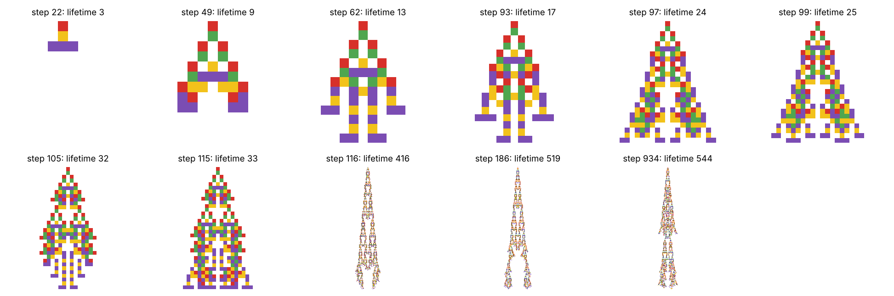
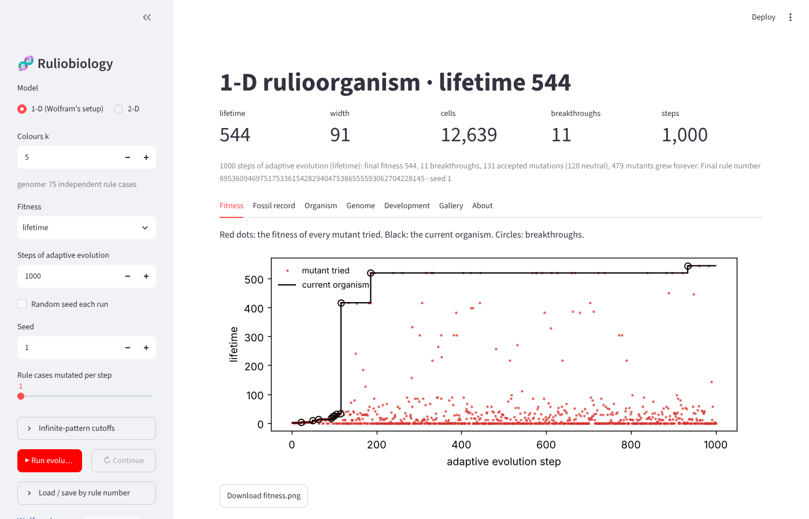
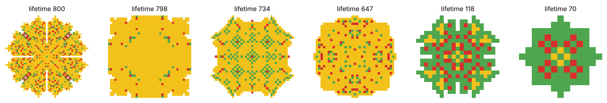
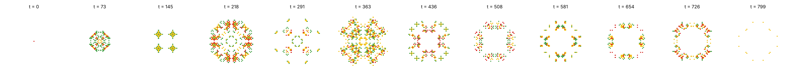
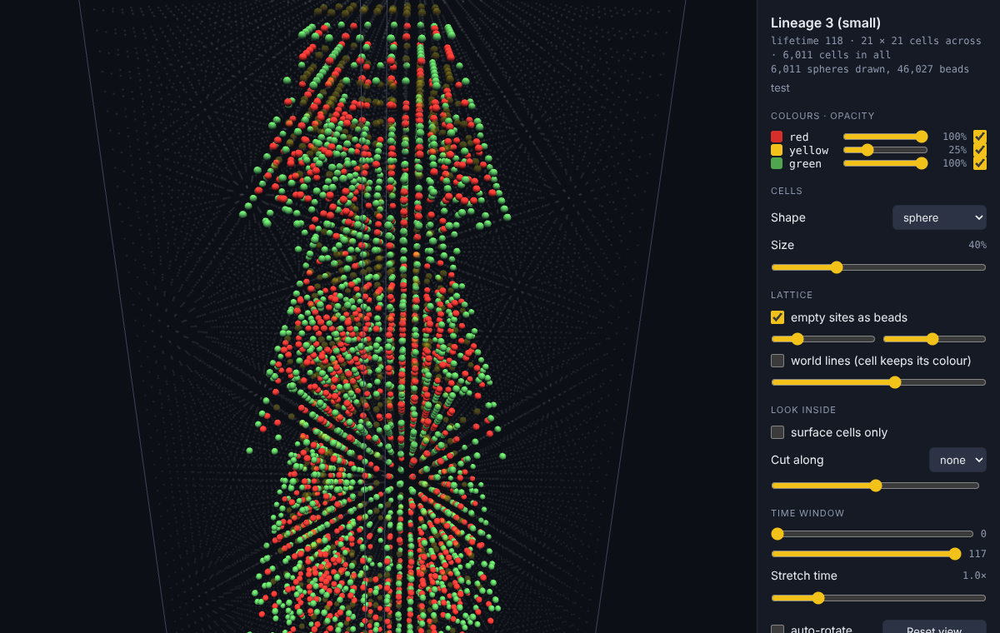

# ruliobiology

Adaptive evolution of simple cellular-automaton rules, after Stephen Wolfram's
essay [*“Endless Forms Most Beautiful and Most Wonderful”: Ruliobiology and the
Theoretical Foundations of Biological Form*](https://writings.stephenwolfram.com/2026/10/endless-forms-most-beautiful-and-most-wonderful-ruliobiology-and-the-theoretical-foundations-of-biological-form/)
(October 2026) — in one dimension, exactly as in the essay, and in two
dimensions, where an organism's whole life becomes a space-time volume you can
rotate in 3-D and look inside.



*A 1-D lineage's "fossil record": the organism at each fitness breakthrough, evolved for lifetime.*

## Contents

- [The model](#the-model)
- [Installation](#installation)
- [Running things](#running-things)
  - [Tests](#tests)
  - [The GUI](#the-gui)
  - [Command-line demos](#command-line-demos)
  - [The 3-D viewer](#the-3-d-viewer)
- [Using the library](#using-the-library)
- [Repository layout](#repository-layout)
- [Design notes and performance](#design-notes-and-performance)
- [Reading](#reading)
- [License](#license)

## The model

Wolfram's *ruliobiology* is a deliberately minimal metamodel of biology:
simple rules, subject to adaptive evolution. The claim of the essay is that the
diversity and complexity of biological form come mostly from the
*computational irreducibility* of the rules themselves — simple rules
routinely produce behaviour that cannot be predicted without running them — and
that natural selection merely finds and keeps the useful pieces.

| Ingredient | In this code |
|---|---|
| A **rulioorganism** is a cellular automaton grown from a single seed cell on an infinite white background. The rule is its genotype; the pattern it grows is its phenotype. | `Rule` / `Rule2D`, `grow()` / `grow2d()` |
| **1-D** (the essay's setup): left–right symmetric, 5-colour, nearest-neighbour rules — 75 independent rule cases. | `ruliobiology.ca1d`; `k` is a parameter |
| **2-D** (this repo's extension): k-colour *outer-totalistic* rules — a cell's next colour depends on its own colour and on how many neighbours have each colour — on the von Neumann (4-cell) or Moore (8-cell) neighbourhood. Such rules are symmetric under every rotation and reflection of the square, the 2-D analogue of the 1-D symmetry, so an organism grown from one cell stays symmetric all its life. | `ruliobiology.ca2d` |
| **Fitness** is, by default, *lifetime*: the number of generations before every cell is white again. Patterns that never die (periodic ones, or ones still growing at a cutoff) have fitness 0. Other fitness functions: width, aspect ratio, total cells, area, amount of one colour, or anything you write. | `fit_lifetime`, `fit_width`, `fit_tall`, `fit_wide`, `fit_cells`, `fit_color(c)`, `fit_area`, `fit_volume` |
| **Adaptive evolution** is a single asexual lineage: each step changes one randomly chosen rule case to a random other colour, and the mutant replaces the parent if its fitness did not decrease (so neutral mutations drift). There is no population, no recombination and no environment — that is the point. | `evolve()` / `evolve2d()`, `evolve_many()` for independent lineages in parallel |

Everything in the essay's first sections can be reproduced: fitness
trajectories with their long plateaus and sudden breakthroughs, the fossil
record of breakthrough organisms, the diversity of forms across lineages,
"extreme" organisms and traits that arise as side effects of selecting for
something else, convergent evolution, divergence from a common ancestor,
conservation of early development, and dissection of an organism into parts
run in isolation.

## Installation

Python 3.10 or newer. The simplest route is the conda environment in the repo
(conda-forge only; [mamba](https://mamba.readthedocs.io) works the same way):

```bash
git clone https://github.com/shimmeringvoid/ruliobiology
cd ruliobiology
conda env create -f environment.yml      # creates an env called "ruliobiology"
conda activate ruliobiology
pip install -e .                         # installs the package into the env, editable
```

The environment holds `numpy`, `matplotlib`, `numba` (optional accelerator,
strongly recommended), `streamlit` (the GUI), `pytest` and `scipy` (used only
by the 2-D tests). Without conda, `pip install -r requirements.txt && pip install -e .`
does the same in any virtual environment; or install just the library with
`pip install -e ".[fast,gui,dev]"`.

The 3-D viewer runs in your browser and loads `three.js` from
cdnjs.cloudflare.com, so it needs an internet connection when the page opens;
nothing else here needs the network.

## Running things

### Tests

```bash
pytest -q          # 26 tests, about 10 s the first time (numba compiles), 5 s after
```

### The GUI

```bash
streamlit run app.py
```

This opens the app in your browser (by default at http://localhost:8501).



- The **sidebar** chooses the model (1-D or 2-D), the number of colours, the
  neighbourhood (2-D), the fitness function, the number of steps, the random
  seed, how many rule cases each mutation changes, and the cutoffs that decide
  when a pattern counts as infinite. **Run evolution** starts a fresh lineage
  from the null rule; **Continue** keeps evolving the current organism.
  Any organism can be saved and reloaded by its *rule number*, which is its
  whole genome as one integer.
- **Fitness** — every mutant tried (red), the current organism (black), the
  breakthroughs (circles).
- **Fossil record** — the organism at each breakthrough.
- **Organism** — the final organism (1-D: the space-time pattern, zoomable;
  2-D: a filmstrip of its life and three projections: the colour each cell had
  when last alive, each cell's birth time, and how many generations it was alive).
- **Genome** — the rule number and the rule itself (1-D: Wolfram-style icons;
  2-D: the table of non-trivial cases).
- **Development** — the first generations of every breakthrough organism side
  by side, which shows Wolfram's *conservation of development*.
- **3-D viewer** (2-D only) — the organism's life as a rotatable space-time
  volume, embedded in the page and downloadable as a stand-alone HTML file.
- **Gallery** — evolve many independent lineages in parallel processes,
  compare them, and load any of them.

Every figure has a download button. A run blocks the page until it finishes
(a 1-D run of 1000 steps takes a few seconds, a 2-D run of 10 000 steps about
a minute with numba); clicking anything else during a run cancels it.

### Command-line demos

```bash
python examples/demo1d.py                        # one 1-D lineage, 1000 steps, seed 1 -> figures/
python examples/demo1d.py --runs 36 --jobs 4     # + a gallery of 36 independent lineages
python examples/demo1d.py --steps 3000 --fitness tall --show
python examples/demo2d.py --runs 6 --steps 15000 --jobs 4     # 2-D -> figures2d/, incl. organism3d.html
python examples/demo2d.py --k 3 --neighborhood moore
python examples/demo1d.py --help
```



*Six 2-D lineages (4 colours, von Neumann) after 15 000 steps, each shown as its footprint.*



### The 3-D viewer

A 2-D organism's form is its (time, y, x) volume. `write_viewer()` turns it into
a self-contained web page, and the GUI's *3-D viewer* tab embeds the same page.



Every cell is a small sphere at the centre of its lattice cube (or a cube, or
a shaded dot sprite — the fastest for very large volumes), with a size slider,
so shrinking the spheres opens gaps you can see through. Drag to rotate, wheel
or pinch to zoom. To look inside: a per-colour opacity slider and visibility
toggle, a cut plane along x or y, a time window, a time-stretch slider, and a
"surface cells only" mode. Two lattice overlays help to read 3-D structure:
*empty sites as beads* draws the empty lattice sites faintly, so the organism's
cells sit as jewels in an Indra's net, and *world lines* join each cell to its
successor in time while its colour persists, so columns and sheets of
persistence stand out. Time runs downward from the seed.

The viewer accepts any `(T, H, W)` integer array with 0 = empty, so an
age-coloured Game of Life history from
[`ca_dynamics`](https://github.com/shimmeringvoid/ca_dynamics) works too.
Rendering uses the GPU through WebGL; a few hundred thousand spheres are fine
on a laptop with a discrete GPU, and the "dot" mode handles millions.

## Using the library

```python
import matplotlib.pyplot as plt
import ruliobiology as rb

# ---- 1-D, Wolfram's setup -------------------------------------------------
ev = rb.evolve(steps=1000, seed=1, progress=True)   # one lineage from the null rule
print(ev.summary())
rb.plot_fitness(ev)              # red: every mutant tried; black: the current organism
rb.plot_breakthroughs(ev)        # the fossil record
rb.plot_organism(ev.rule)        # the final organism
rb.plot_rule(ev.rule)            # its genome as rule icons
rb.plot_development(ev)          # first 30 generations of each breakthrough organism
plt.show()

s = rb.stats(ev.rule)            # Stats(lifetime=544, width=91, counts=(...)) -- no picture needed
s.cells, s.aspect, s.color_fractions

n = ev.rule.to_number()          # the genome as one integer; save it anywhere
rule = rb.Rule.from_number(n)

# other fitness functions, including your own (Stats -> number, 0 means reject)
rb.evolve(steps=1000, fitness=rb.fit_tall)
rb.evolve(steps=1000, fitness=rb.fit_color(3))                      # as green as possible
rb.evolve(steps=1000, fitness=lambda s: s.width + s.lifetime if s.finite else 0)

# many independent lineages, in parallel (diversity, extremes, side effects)
evs = rb.evolve_many(100, steps=1000, seed=0, n_jobs=8)
rb.plot_gallery([e.rule for e in evs if e.fitness > 500], ncols=8)
widths = [rb.stats(e.rule).width for e in evs]                       # a trait nobody selected for

# open-ended evolution, divergence, development, parts in isolation
ev2 = rb.evolve(steps=1000, start=ev.rule, seed=2)                  # keep going
whole = ev.extend(ev2)                                               # one continuous record
descendants = [rb.evolve(steps=200, start=ev.rule, seed=i).rule for i in range(6)]
early = rb.used_cases(ev.rule, steps=10)                             # rule cases expressed early
hist = rb.grow(ev.rule)
patch = hist[len(hist) // 2, 10:40]                                  # a slice of one row ...
rb.plot_organism(rb.grow(ev.rule, steps=60, initial=patch))          # ... run on its own

# ---- 2-D ----------------------------------------------------------------------
ev = rb.evolve2d(steps=15000, seed=3)                # k=4, von Neumann, lifetime fitness
vol = rb.grow2d(ev.rule)                             # (lifetime, H, W) uint8 space-time volume
rb.plot_filmstrip(vol)                               # 12 generations across its life
rb.plot_projection(vol, "last_color")                # footprint; also "birth", "death", "count"
rb.write_viewer(vol, "organism.html", title="Lineage 3")    # the rotatable 3-D page
rb.evolve2d(k=3, neighborhood="moore")               # other rule families
rb.evolve2d(fitness=rb.fit_area)                     # biggest at some moment, then die
evs = rb.evolve2d_many(12, steps=15000, seed=0, n_jobs=4)
```

The two models share one evolution loop (`ruliobiology.ca1d.evolve`, which
takes an `evaluate` function and a per-step `callback` for progress bars), one
`Evolution` record (`.rule`, `.fitness`, `.attempts`, `.best`, `.lineage`,
`.breakthroughs`, `.summary()`, `.extend()`), and the same fitness functions.

## Repository layout

```
ruliobiology/
├── ruliobiology/            the package
│   ├── __init__.py          re-exports the public API
│   ├── ca1d.py              1-D model: Rule, stats, grow, fitness functions, evolve, plots
│   ├── ca2d.py              2-D model: Rule2D, stats2d, grow2d, projections, evolve2d
│   └── viewer3d.py          write_viewer(): the rotatable 3-D space-time page (three.js)
├── app.py                   the GUI:  streamlit run app.py
├── examples/
│   ├── demo1d.py            reproduce the essay's basic 1-D figures from the command line
│   └── demo2d.py            evolve 2-D lineages, draw them, write the 3-D page
├── tests/                   pytest suites for both models and the viewer
├── docs/images/             figures used in this README
├── environment.yml          conda environment (name: ruliobiology)
├── requirements.txt         pip alternative
└── pyproject.toml           pip install -e .
```

## Design notes and performance

- **Lifetime** counts non-white generations, so the null rule (the seed dies at
  once) has lifetime 1, and an organism's picture has exactly `lifetime` rows
  (1-D) or frames (2-D).
- **Infinite patterns.** Periodic patterns are detected exactly, by hashing each
  generation. Growing ones are declared infinite after `max_steps` generations
  (1-D default 3000, 2-D default 1000) or, in 2-D, when wider than `max_width`
  (default 100). In 1-D the time cap sets the cost of an infinite mutant
  (roughly `max_steps²`); in 2-D a pattern growing at light speed costs about
  t³ cell updates, so the width cap is what keeps runs fast. Raise the caps to
  find longer-lived organisms.
- **Symmetry.** 1-D: a mutation of case (a, b, c) also sets (c, b, a), and the
  fast kernel simulates only the right half of the pattern. 2-D: outer-totalistic
  rules are D4-symmetric by construction, and the kernel simulates one quadrant.
- **Genome size matters in 2-D.** A mutation only does anything when it hits a
  rule case the organism actually uses, and a small organism uses a few dozen.
  With 140 cases (k = 4, von Neumann — the default) or 135 (k = 3, Moore),
  evolution gets going in a few thousand steps and reaches lifetimes of several
  hundred in 10–20 thousand; with 660 cases (k = 4, Moore) it needs tens of
  thousands of steps. Wolfram's 75-case 1-D genome, about half of it expressed,
  turns out to be a sweet spot.
- **Neutral drift.** Because mutations that leave fitness unchanged are
  accepted, the unexpressed part of the genome random-walks. One consequence:
  roughly one 1-D lineage in six never leaves lifetime 1 in 1000 steps, because
  every mutation that would make the seed do anything lands on a drifted genome
  whose patterns all grow forever. That is a feature of the model, not a bug.
- **Speed.** With numba, a 1-D lineage of 1000 steps takes 1–3 s (the first
  call adds ~2 s of compilation, cached on disk afterwards) and a 2-D lineage of
  15 000 steps about 15 s; most of the time goes to discovering that mutants
  grow forever. The pure-numpy fallback is 5–10× slower. `evolve_many(...,
  n_jobs=N)` runs independent lineages on N processes. Evolution itself is CPU
  work; the GPU is used by the 3-D viewer (WebGL). A GPU-batched evaluator for
  many lineages at once would be a natural next step.
- **Colours.** 0 white, 1 red, 2 yellow, 3 green, 4 purple, 5 blue, ... (the
  colours Wolfram names in the essay). The seed cell is colour 1.
- **Rule numbers** read the outputs of the independent rule cases, in a fixed
  order, as a base-k integer (75 digits in 1-D, 140 for the default 2-D
  family). They are the compact way to save, share and reload a genotype.

## Reading

- S. Wolfram, [*“Endless Forms Most Beautiful and Most Wonderful”: Ruliobiology and the Theoretical Foundations of Biological Form*](https://writings.stephenwolfram.com/2026/10/endless-forms-most-beautiful-and-most-wonderful-ruliobiology-and-the-theoretical-foundations-of-biological-form/), Stephen Wolfram Writings, October 23, 2026 — the essay this repository implements.
- S. Wolfram, [*Why Does Biological Evolution Work? A Minimal Model for Biological Evolution and Other Adaptive Processes*](https://writings.stephenwolfram.com/2024/05/why-does-biological-evolution-work-a-minimal-model-for-biological-evolution-and-other-adaptive-processes/) (May 2024) — the original model.
- S. Wolfram, [*Foundations of Biological Evolution: More Results & More Surprises*](https://writings.stephenwolfram.com/2024/12/foundations-of-biological-evolution-more-results-more-surprises/) (December 2024).
- S. Wolfram, [*What's Special about Life? Bulk Orchestration and the Rulial Ensemble in Biology and Beyond*](https://writings.stephenwolfram.com/2025/11/whats-special-about-life-bulk-orchestration-and-the-rulial-ensemble-in-biology-and-beyond/) (November 2025).
- S. Wolfram, [*What Is Ruliology?*](https://writings.stephenwolfram.com/2026/01/what-is-ruliology/) (January 2026).
- R. Espericueta, [*Cellular Automata Dynamics: Explorations in Parallel Processing*](https://github.com/shimmeringvoid/ca_dynamics) (1997; second edition with Python software, 2026) — the companion book and package.

## License

MIT — see [LICENSE](LICENSE). Copyright © 2026 Rafael Espericueta.
